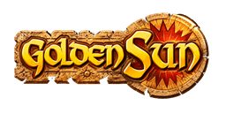

# Golden Sun - Dual Screen Companion



**Golden Sun - Dual Screen Companion** (working title; the repository and file names still say GoldenSun3DS): play **Golden Sun** and **Golden Sun: The Lost Age** on a Nintendo 3DS with a touch companion on the bottom screen: party, Psynergy, Djinn, a live exploration map, items, battle info and more. The game itself runs on the top screen through the [mGBA](https://mgba.io) core, using your own ROMs.

> ## Beta v0.1.0
> This is the first public test build. **We are looking for obvious problems**: crashes, freezes, menus that do something wrong, wrong numbers on the bottom screen, installer trouble. Please [open an issue](../../issues/new?template=bug_report.md) with what you did, what you expected, and your console (New / Old 3DS, real hardware or Azahar). The line at the bottom of the **Menu** tab (`NNfps ... eMM ... cNN`) helps a lot for speed reports.

## What you need
- A 3DS with custom firmware (to install a `.cia` with FBI, or to run `.3dsx` files from the Homebrew Launcher), **or** the [Azahar](https://azahar-emu.org) emulator (Windows/Android).
- Your own dumps of the games (`.gba`). **No ROMs are included and none will ever be.**
- A Windows PC to run the installer/patcher (PowerShell, included in Windows).

## Install (easy way)
1. Download `GoldenSun3DS_Patcher_v0.1.0-beta.zip` from the [latest release](../../releases) and unzip it.
2. Double-click **GoldenSun3DS-Patcher.exe** (Windows may show a "Windows protected your PC" warning because the file is not code-signed: choose *More info > Run anyway*, or use **Install.bat** instead).
3. Pick **New 3DS** (two cores, aims for 60 fps) or **Old 3DS** (single core, about 25-35 fps).
4. Choose **.cia** (one installable file with your ROMs inside) or **SD card files**, pick your ROM(s) (optionally your `.sav` files) and press **Build**.
   Tick **"Also make a .3ds file for emulators"** if you also want a `.3ds` cartridge image for an emulator such as Azahar (File > Open); it does not run on a real console.
5. Install the `.cia` with FBI (or in Azahar: *File > Install CIA*) and start it from the HOME Menu. Saves and settings live in `sdmc:/3ds/GoldenSun3DS/`.

If you only add one game, the other one is greyed out on the pick screen.

## Playing in an emulator (Azahar)
Build the `.3ds` with the patcher (tick **"Also make a .3ds file for emulators"**), open it in [Azahar](https://azahar-emu.org) and set the emulator to
**New 3DS mode with the CPU clock at about 300%**. Sound needs no dump from a real 3DS: the app creates the placeholder file the audio library asks for.
Full step-by-step guide, sound details and troubleshooting: **[docs/EMULATORS.md](docs/EMULATORS.md)**.

> **Old 3DS and slow machines:** on an Old 3DS (or an emulator left at its default 100% CPU clock, which behaves like one) the game runs slower,
> roughly 25-35 fps, and **the automatic helpers (frame skip, Mute if slow) may not be able to fix that**. The game then plays in slow motion and the sound
> is slow and choppy. This is a limit of the hardware, not a bug, and fast forward is not offered for the same reason.

## Roadmap
This is built for the New 3DS XL; support for other devices (a desktop build, then an Android `.apk` running natively with Android audio) is being worked on. Until then, feel free to try the `.3ds` / `.cia` on other devices and report how it goes. Details: **[docs/ROADMAP.md](docs/ROADMAP.md)**.

## Menu options (Menu tab)
These start **Off** on a fresh install; turn on the ones you want.
- **Menus below:** when you open one of the game's own menus (items, Psynergy, ...) it is moved to the bottom screen as touch buttons, and the top screen keeps showing the field.
- **Mute if slow:** silences the sound whenever the game runs under about 54 fps (a slow device or emulator), instead of playing slow, choppy audio.
- **Autosave** (on by default), **Top screen** (1X or Fill), **Save slots**, **Rewind 5s**, **Message log** and **Bestiary** are the other entries.

## What it does
- **Bottom screen tabs**: Party (tap a member for the character screen), Psynergy, Djinn, Map, Items, Menu, plus an automatic Battle panel with enemy info and turn order.
- **Touch actions through the game's own menus**: tap an item to equip it (with a stat-change preview), "Equip best", tap a Psynergy to cast it, tap a Djinn to Set / Standby it, Djinn **Sets** (save and apply layouts), **Repeat round** in battle, a Lost Age password keyboard.
- **Map**: the complete area is drawn from your own ROM (USA / Europe cartridges) with your position marked, from the first step. The world maps and other cartridge versions use a live map stitched from the game's frames instead.
- **Quality of life**: message log, rewind 5 s, three save-state slots with thumbnails, autosave and resume, rotating `.sav` backups, fast forward, item descriptions, enemy details.

Full details: [docs/FEATURES.md](docs/FEATURES.md).

## Known limitations in this beta
- **Old 3DS, and emulators at their default speed, run slow.** Roughly 25-35 fps; automatic frame skip and **Mute if slow** may not be able to compensate (slow motion, choppy sound). See [docs/EMULATORS.md](docs/EMULATORS.md) for the emulator settings that fix it on a fast PC or phone.
- **Speed depends on the console.** Old 3DS cannot reach full speed. Fast forward cannot go faster than your console can emulate; it is capped to keep the picture smooth. The Menu footer shows the real numbers (`e` = ms per emulated frame, `c` = CPU benchmark: about 30 means the New 3DS clock is active, about 90 means it is not).
- The Lost Age has the same tabs and touch actions as Golden Sun; its world map is not drawn from the ROM yet, and a few touch actions (Repeat round, Equip best with better gear) were only lightly tested there (see [docs/LOST_AGE.md](docs/LOST_AGE.md)).
- **Lightly tested**: Repeat round, Djinn set Save / Apply / All Set, Equip best on real hardware. Android dual-screen devices have not been tested (only Azahar on Windows).
- **Sound safety net**: if audio start-up ever crashes a console, the next launch runs without sound instead of crashing again (a "Sound off" message shows); delete `sdmc:/3ds/GoldenSun3DS/audio_crash.flag` to try sound again. (The first .cia build crashed at game start on a New 3DS because the .cia did not declare the DSP memory range; fixed in the current build.)
- **Sound in emulators**: in Azahar / Citra the app writes a placeholder `dspfirm.cdc` into the emulator's virtual SD on first start (the audio library demands the file; the emulator's built-in audio ignores its contents), so no dump from a real 3DS is needed. Sound only plays at the right pitch and speed if the emulator runs the game at full speed: set Azahar's CPU clock to about 300-400% and enable New 3DS mode, otherwise the audio is slow and choppy. The Menu tab footer shows `(no audio)` while sound is unavailable and `(muted: slow)` when **Mute if slow** is silencing a device that cannot hold full speed.
- Autosave is on by default and resumes where you quit. Turn it off in **Menu** if you would rather start fresh.

## Build from source
Needs [devkitPro](https://devkitpro.org) (devkitARM + libctru + 3ds tools), Python 3 and PowerShell.
```
git clone --recurse-submodules <this repo>
# one-time: build the mGBA core for the 3DS (see docs/BUILDING.md), then
make                      # -> build/app/GoldenSun3DS.3dsx
powershell -ExecutionPolicy Bypass -File tools/make_dist.ps1   # -> dist/releases/v<version>-<stage>/GoldenSun3DS_Patcher_v<version>-<stage>.zip
python3 tools/selftest.py # host-side tests (needs gcc and a host build of mGBA, see docs/BUILDING.md)
```
`tools/make_dist.ps1` also needs `makerom.exe` and `bannertool.exe` (both MIT licensed) in `tools/patcher/bin/`.

## Credits and legal
- Emulation: [mGBA](https://github.com/mgba-emu/mgba) by endrift and contributors (MPL-2.0). Pinned as a submodule at `third_party/mgba`.
- The CIA output uses `makerom` (3DSGuy) and `bannertool` (Steveice10), MIT licensed.
- UI text uses the Ubuntu Font Family (Ubuntu Font Licence 1.0, (c) Canonical Ltd).
- Golden Sun and The Lost Age are (c) Nintendo / Camelot Software Planning; "Golden Sun" is used here only to say which games this works with. This is an unofficial, free fan project, **not affiliated with or endorsed by Nintendo or Camelot**. It contains **no game code and no ROMs** (you supply your own), and it never uploads or shares anything.
- Maps, class, item, Psynergy and Djinn names are read out of *your own* ROM at run time and are never stored or shipped. The game-pick banners and portraits are fan art. The character portraits, item icons, Psynergy icons and Djinn sprites in the interface are captured from the games' own menus, and the title logo and app icon are fan-made renditions; they are used only for the interface. If a rights holder objects, tell us by opening an issue and they will be removed promptly.
- See [THIRD_PARTY_NOTICES.md](THIRD_PARTY_NOTICES.md). Project code is under the [MIT License](LICENSE).
